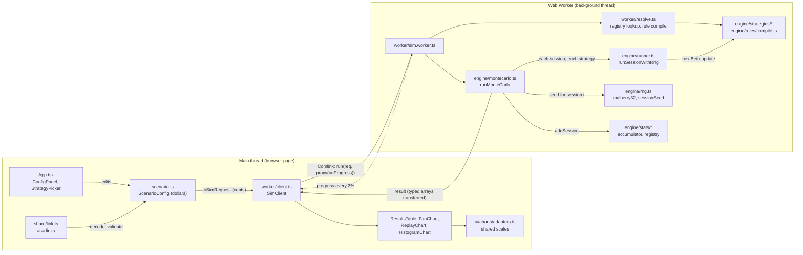

# StrategyLab: an author's guide to the codebase

This guide is for reading the code, not for changing the rules. The rules live in `CLAUDE.md`, the detailed specs in `docs/spec.md`, and the record of what was verified and when in `docs/history.md`. Where this guide and those files disagree, they win. Line numbers were checked on 2026-10-13 (commit `b14f63d`, and again after the session 18 changes); they drift as code changes, so search for the named function if a number is off.

Suggested reading plan: evening 1, sections 1 and 2. Evening 2, section 3 (the core ideas), with the files open beside it. Evening 3, sections 4 and 5, then run the tests once and read their output.

---

## 1. The five-minute overview

**What it does.** You pick a game (European roulette, a coin flip, sports odds, or your own list of outcomes), a bankroll and table limits, and up to eight betting strategies. StrategyLab plays thousands of simulated sessions for every strategy and shows the results side by side: a table of statistics, a fan chart of bankroll over time, a replay of a single session, and a histogram of where sessions end.

**The one fact the whole app is built to show.** In a game with a house edge, every bet loses `edge × stake` on average, no matter what happened before. So for any strategy, the expected loss is `edge × total amount wagered`. A strategy can change how much you wager and how the results are spread out (Martingale: many small wins, rare huge losses), but it cannot change the loss per dollar wagered. That number, "EV per $ wagered", is the headline row of the results table, and it is also the engine's main correctness test: if any strategy ever measures a different value, the engine is wrong.

**How it is put together.** Four layers, each in its own folder:

| Layer | Folder | What it does | Talks to |
|---|---|---|---|
| Engine | `src/engine/` | Pure TypeScript: random numbers, games, strategies, the session loop, Monte Carlo, statistics, the rule language. No React, no browser APIs. | nothing (everything calls it) |
| Worker | `src/worker/` | Runs the engine in a background thread so the page never freezes. | engine; the UI via Comlink |
| Share | `src/share/` | Turns a scenario into a link (`#s=...`) and back, treating every link as hostile input. | engine validators, `scenario.ts` |
| UI | `src/App.tsx`, `src/ui/` | React forms, the results table, and the canvas charts. | worker, share |

`src/scenario.ts` sits in the middle: it defines `ScenarioConfig`, the one plain-JSON object that holds everything the user has set. Because it is plain data, a link can carry it and a worker message can carry it.

**Numbers worth knowing.** Up to 1,000,000 sessions per run (`MAX_SESSIONS`, `src/engine/montecarlo.ts:15`), up to 8 strategies (`MAX_STRATEGIES`, `src/scenario.ts:130`), 8 built-in strategies (`src/engine/strategies/registry.ts:12-21`), 719 Vitest tests plus 44 Playwright tests (README, verified 2026-09-29).

---

## 2. Architecture, and the path of one run

### The diagram

### One run, step by step

Follow this with the files open. It is the single most useful thing to understand.

1. **The user edits the form.** Every edit replaces the `ScenarioConfig` held in React state in `App` (`src/App.tsx:40`). Nothing about the scenario is hidden in a component's own state, which is why a link can capture all of it.
2. **Validation runs on every change.** `validateScenario` (`src/scenario.ts:194`) returns field errors; `canRun` is true only when there are none (`src/App.tsx:109-110`). The Run button is disabled otherwise.
3. **Run is clicked.** `handleRun` (`src/App.tsx:140`) snapshots the scenario and calls `toSimRequest` (`src/scenario.ts:291`), which converts dollars to integer cents with `toCents` (`src/scenario.ts:172`) and turns each strategy into plain data: a built-in is `{ strategyId, config }`, a custom rule is the rule's JSON. Functions cannot be sent to a worker, so nothing in the request is code.
4. **The client sends it to the worker.** `SimClient.run` (`src/worker/client.ts:35`) calls the worker through Comlink and wraps the progress callback in `Comlink.proxy` (`src/worker/client.ts:39`), so the worker can call it back across threads.
5. **The worker turns data back into strategies.** `api.run` (`src/worker/sim.worker.ts:25`) calls `resolveStrategies` (`src/worker/resolve.ts:13`): built-ins are looked up in the registry, and custom rules are validated and compiled right here (`src/worker/resolve.ts:17`). A bad rule fails the run with a readable message.
6. **Monte Carlo loops over sessions.** `runMonteCarlo` (`src/engine/montecarlo.ts:59`) validates its inputs, then for each session `i` computes one seed (`src/engine/montecarlo.ts:94`) and runs EVERY strategy on that same seed (`src/engine/montecarlo.ts:95-119`). The first 2,000 sessions get an observer that records percentile bands; the first 50 also record a downsampled path for the spaghetti lines (`src/engine/montecarlo.ts:101-114`). Every other session pays only an `if` check.
7. **One session is played.** `runSession` (`src/engine/runner.ts:60`) creates the random generator and hands off to `runSessionWithRng` (`src/engine/runner.ts:92`). Each round: check the stop conditions, ask the strategy for a bet, apply table rules, draw ONE random number, pay out, and tell the strategy what happened (`src/engine/runner.ts:121-169`).
8. **Each session's result is folded into an accumulator.** `addSession` (`src/engine/stats/accumulator.ts:72`) adds running sums and writes one number per session into four typed-array columns (final bankroll, max drawdown, longest losing streak, and rounds played if the session busted). Paths are never kept.
9. **Progress is reported about every 2%.** `src/engine/montecarlo.ts:120-126`. The callback is the proxied function from step 4, so each call is a message back to the page, which updates the progress bar.
10. **Statistics are computed once at the end.** Every registered stat runs on each strategy's accumulator (`src/engine/montecarlo.ts:141`). The histogram uses one set of bins for all strategies (`src/engine/montecarlo.ts:131`).
11. **The result goes back without copying.** `Comlink.transfer(result, resultTransferables(result))` (`src/worker/sim.worker.ts:30`) hands the typed arrays' memory to the page instead of copying it. The per-session columns are not in the result at all; they never leave the worker.
12. **The page draws.** `handleRun` stores the result (`src/App.tsx:156`). `ResultsTable` renders one row per registered stat, with each 95% interval shown in its stat's row. `FanChart` computes ONE set of axes for all panels with `fanScales` (`src/ui/charts/FanChart.tsx:28`, defined at `src/ui/charts/adapters.ts:89`), so Martingale's panel and Flat's panel are drawn on the same scale.

**Cancel** works differently from a normal "stop" button. The worker is running one long synchronous loop and cannot receive a message mid-loop, so `cancel` simply kills the worker and starts a fresh one (`src/worker/client.ts:58-64`).

**Replay** (clicking a line in the fan chart) does not look anything up. It re-plays session `i` for every strategy from its seed in the worker (`src/worker/sim.worker.ts:34`, `src/engine/replay.ts:69`). Because the seed fully determines the session, the replay is exactly the session that was summarized.

---

## 3. The core ideas, where they live, and why

### 3.1 Seeded randomness

**Where.** `src/engine/rng.ts`. `mulberry32` (line 15) is a small, fast 32-bit generator: give it a seed and it returns a function that produces numbers in [0, 1). `splitmix32` (line 7) is a hash that scrambles a number thoroughly. `sessionSeed` (line 29) combines them: session `i`'s seed is `splitmix32(masterSeed ^ splitmix32(i))`.

**Why.** Two reasons. First, reproducibility: the same seed always gives the same run, down to the last cent, so a shared link reproduces the exact numbers someone else saw, and a test can assert exact values. Second, independence between sessions: the obvious choice, `masterSeed + i`, is a known trap with mulberry32, because seeds that differ by one produce correlated streams. Hashing the index first spreads neighbouring sessions across the whole seed space.

**Is the generator itself any good?** `src/engine/rng.stats.test.ts` runs a chi-square goodness-of-fit test: 1,000,000 draws in 100 equal bins, compared with the 1-in-10,000 critical value for 99 degrees of freedom (160.17). One long mulberry32 stream scores 74.2, and the first draw across 1,000,000 consecutive session seeds scores 92.2; both are well inside. Two deliberately broken stubs (`u^1.05`, and one that never lands in one bin) score 2,530 and 20,516, which proves the test can fail. What it does not check: independence between successive draws. That is covered indirectly, by the invariant and CRN tests in 3.2 and 3.8.

**How it is enforced.** `Math.random` is banned in the engine, and a test scans every engine file for it (`src/engine/isolation.test.ts:15`). The same test bans React and DOM globals, which keeps the engine runnable in Node tests and in the worker alike.

### 3.2 Common random numbers (CRN)

**Where.** The loop in `src/engine/montecarlo.ts:93-119` gives every strategy the same seed for session `i`. The runner draws exactly one number per round (`src/engine/runner.ts:138`), and only after every check that could end the session early (steps 1-6 in the comment at `src/engine/runner.ts:75-83`).

**What it means.** Session 7 of Martingale and session 7 of Flat see the identical sequence of wins and losses for as long as both are still playing. Strategies never touch the generator; they only see the result of each round.

**Why.** It makes comparisons fair and sharp. If each strategy got its own random outcomes, some of the difference between them would be luck. With shared outcomes, every difference is caused by the strategy. It is the same idea as testing two drugs on the same patients. It also makes the replay chart honest: one win/loss strip is drawn for all strategies, because they really did share it.

**The subtle part: "exactly one draw per round".** If a strategy that stopped early, or a round that ended because of a table rule, consumed a random number, every later round would shift and the strategies would stop seeing the same outcomes. That is why the runner checks stops, ruin, max rounds, the strategy's "stop" and insufficient funds before it draws.

**Tests.** `src/engine/strategies/crn.test.ts` runs all 8 built-ins plus a custom rule and checks that for 50 sessions every pair saw identical outcomes over their overlapping rounds. `src/engine/runner.test.ts:135-165` uses a counting generator to show `draws === rounds` for every way a session can end, including 2,400 random sessions.

### 3.3 Integer money and the sub-cent carry

**Where.** `src/engine/runner.ts:140-147`.

**Why.** Money is whole cents everywhere in the engine, so progressions like Martingale do not pile up floating-point error. But some payouts are not whole cents: a $5 bet at sports odds of −110 wins 454.5454… cents. Rounding each win to 455 cents looks harmless, but it biased EV per $ wagered by about 5 standard errors at 100,000 sessions (`docs/history.md` STATUS 89). The fix keeps the leftover fraction in a per-session `carry`, so the bankroll stays in whole cents and the running total is never more than half a cent from exact. Integer payouts give a carry of exactly 0, so even-money results did not change by a single bit (the golden test in 3.6 proves it).

### 3.4 The Web Worker

**Where.** `src/worker/sim.worker.ts` (the worker side, exposed with `Comlink.expose` at line 43), `src/worker/client.ts` (the page side, `SimClient` at line 17), `src/worker/resolve.ts` (turning plain data into strategies).

**Why.** A big run is seconds of pure computation. On the page's main thread that would freeze typing, scrolling and the Cancel button. In a worker, the page stays responsive; the session 1 check recorded zero main-thread tasks over 50 ms during a 100,000-session run (`docs/history.md` STATUS 9), and `e2e/responsiveness.spec.ts` keeps checking it.

**Design choices worth being able to explain:**
- **Comlink** hides `postMessage` behind ordinary async function calls, so `client.run(req, onProgress)` reads like a local call.
- **Only data crosses the boundary.** Strategies are objects with functions, which cannot be posted to a worker. So the request carries a registry id or rule JSON, and the worker rebuilds the strategy (`src/worker/resolve.ts:10-26`). A side effect is security: the worker validates every rule itself instead of trusting the page.
- **Transfer, not copy.** The result's typed arrays are transferred (`src/engine/montecarlo.ts:158-165`), which moves their memory instead of copying it.
- **Cancel = terminate and respawn** (`src/worker/client.ts:58`), because a synchronous loop cannot be interrupted by a message.
- **Memory does not grow with run length.** Per session the engine keeps four numbers per strategy. Bands keep only checkpoint values for 2,000 sessions, and sample paths are downsampled to at most 1,000 points (`MAX_PATH_POINTS`, `src/engine/montecarlo.ts:18`). The owner rejected storing full paths in session 3: 2,000 full paths at 1,000,000 rounds would be about 16 GB (`docs/history.md`, Decisions).

### 3.5 The rule compiler and its safety limits

Users can write their own progression ("double after a loss, but go back to 1 unit after three losses in a row") without writing code. A rule is JSON data; it is checked against a fixed grammar and then interpreted. The grammar is documented in `docs/spec.md` ("Rule language").

**Where.**
- `src/engine/rules/types.ts`: the grammar as TypeScript types.
- `src/engine/rules/limits.ts:9-29`: every limit in one place (40-character names, 10 entries per list, 20 numbers per sequence, 20,000 characters of pasted JSON, and a numeric range for every field).
- `src/engine/rules/validate.ts:238`: `validateRule`, the gatekeeper.
- `src/engine/rules/compile.ts:128`: `compileRule`, which validates and then builds a `Strategy`.

**How the validator protects the app:**
- It accepts only plain objects, the kind `JSON.parse` produces (`isPlainObject`, `validate.ts:48`), and reads only an object's own properties, never inherited ones (`own`, `validate.ts:55`). That shuts out prototype tricks such as a `__proto__` key.
- Every object must have exactly the allowed keys (`keys`, `validate.ts:91`). Unknown keys are errors, not ignored.
- Every number must be finite and in range (`number`, `validate.ts:108`), so NaN, Infinity and absurd values never reach the engine.
- List lengths are checked before the list is walked (`validate.ts:159`, and `hardListCap` for sequences at `validate.ts:214`), so a million-entry list costs nothing.
- It never throws: a `try/catch` turns even exotic input into an error message (`validate.ts:253-256`).
- On success it returns a fresh, deep-frozen copy built only from known keys (`deepFreeze`, `validate.ts:225`). The original input is never used again.

**How the compiler stays safe.** It is a `switch` over the closed list of condition and action types (`holds` at `compile.ts:33`, `apply` at `compile.ts:49`). No code is ever generated, so there is nothing to inject into. Units are clamped after every action (`clampUnits`, `compile.ts:31`) so a rule cannot produce an infinite or negative bet, and the bet is capped at `Number.MAX_SAFE_INTEGER` (`compile.ts:81`), the same guard Martingale uses. Work per round is at most 10 condition checks.

**Why it is built this way.** Rules travel inside share links, so anyone can hand you one. A link must never be able to run code, hang the page or crash it. `src/engine/rules/noEval.test.ts:18-26` scans the rule pipeline, worker, scenario and link code for `eval`, `new Function`, dynamic `import()` and similar, and includes a self-test proving the scan catches each form.

**Proof the compiler is right.** Four shipped example rules reproduce built-in strategies (`src/engine/rules/examples.ts`). `src/engine/rules/equivalence.stats.test.ts` runs each pair on the same seeds for 10,000 sessions and requires bit-identical results. `src/engine/rules/fuzz.stats.test.ts` generates 200 random valid rules (all must satisfy the EV invariant, line 99) and 200 invalid ones (all must be rejected, line 243).

### 3.6 The share URL format

**Where.** `src/share/link.ts` (encode and decode), `src/share/compact.ts` (short keys), `src/share/base64url.ts` (a strict hand-written decoder), `src/share/limits.ts` (the caps). Full format in `docs/spec.md` ("URL scenario format").

**The format.** `#s=` followed by base64url of a compact JSON scenario. It lives in the fragment (after `#`), which browsers never send to a server, so no scenario data ever appears in a server log.

**The decoder's pipeline** (`parseFragment`, `link.ts:102`, then `decodeScenarioLink`, `link.ts:135`), each stage cheap and bounded:
1. Reject anything longer than 8,000 characters before decoding (`link.ts:104`; the cap is `MAX_URL_CHARS` at `limits.ts:12`).
2. Strict base64url decode that reports a position instead of throwing (`base64url.ts:29`).
3. Strict UTF-8 decode (`fatal: true`, `link.ts:111`).
4. A linear scan rejects nesting deeper than 16 levels BEFORE `JSON.parse` sees the text (`jsonDepthExceeds`, `link.ts:81`; used at `link.ts:115`), so a "bracket bomb" never reaches the parser.
5. `JSON.parse`, then require a plain object (`link.ts:124`).
6. Check the version. A link from a newer app asks the user to reload (`link.ts:145`); older versions are migrated with the same `migrateScenario` the app uses.
7. Expand short keys with type checks (`expandPayload`, `compact.ts:338`), run custom rules through `validateRule`, and run the whole scenario through `validateScenario`.
8. **Partial load** (`settle`, `link.ts:189`): a bad field falls back to its default, a bad strategy is left out, and the user is told exactly what was dropped. The loop is capped at 64 passes (`link.ts:193`).

Opening a link never starts a simulation. **Tests:** `src/share/malicious.test.ts:111` onwards covers prototype-pollution keys, deep nesting, huge strings, bad base64, every truncation of a real link, invalid UTF-8, hostile versions and wrong types. Round trip, size budget, migration and old-version goldens are in the other `src/share/*.test.ts` files and `src/v3links.golden.test.ts`.

### 3.7 Statistics as plug-ins

**Where.** `src/engine/stats/registry.ts:71` (`STATS`, the ordered list the results table renders), `src/engine/stats/accumulator.ts` (the single-pass collector), `src/engine/stats/quantile.ts:12` (`quantileSorted`, the one percentile function).

**Why.** Adding a statistic should be one line, not a UI change. The table loops over `TABLE_ROWS` (`src/ui/ResultsTable.tsx:43`), which is `STATS` in order with each interval's low/high rows folded into its point row (`INTERVAL_ROWS` and `TABLE_ROWS`, `src/ui/format.ts:54` and `:76`), so a new entry appears automatically, and the E2E helper compares every row to the engine. All percentiles go through one function so they are consistent (the "type 7" definition, the same as numpy's default).

The headline: `evPerWagered` and its standard error `evPerWageredSE` (`registry.ts:8` and `registry.ts:14`). EV per $ is a ratio (total profit ÷ total wagered), so its SE uses the delta method from running sums (`sumProfitSq`, `sumWageredSq`, `sumProfitWagered` in the accumulator) rather than storing every session.

**Risk metrics with honest uncertainty** (session 18). P(profit > 0) and P(bust) each get a 95% interval from `wilsonInterval` (`src/engine/stats/interval.ts:11`). The Wilson score interval is used instead of the textbook p ± 1.96·SE because it stays inside [0, 1] and still gives a real upper bound when nothing happened: 0 busts in 10 sessions gives [0%, 27.8%], not [0%, 0%]. "Rounds to bust" (median and 10th percentile) looks only at sessions that busted. It uses a fourth per-session column, `bustRounds`, which holds the rounds played for a busted session and NaN for every other one. Sorting puts the NaNs last, so the first `bustCount` sorted values are exactly the busted sessions (`sortedBustRounds`, `src/engine/stats/accumulator.ts:102`), and the percentile still goes through `quantileSorted`. "P(max drawdown ≥ 50% of start)" reuses the drawdown column. In the default run these show the core contrast in a new way: Martingale ×2 busts in 17.07% of sessions (95% interval 16.35% to 17.82%), and half of those busts happen by round 14; Flat's busts come at a median of round 874.

### 3.8 The statistical tests and their tolerances

A Monte Carlo result is never exactly the theoretical value; it wobbles. The question is how much wobble is acceptable.

**The rule.** Tolerance = 4 standard errors, with the SE computed from the samples in that test, and printed. Seeds are fixed, so the tests are deterministic. 4 SE means a correct engine fails by chance about 6 times in 100,000 checks, while a real bias of a few SEs gets caught.

**Where.**
- `evPerWageredWithSE` (`src/engine/testUtils.ts:188`) computes the ratio and its SE from per-session samples.
- `describeEvInvariant` (`src/engine/testUtils.ts:159`) is the per-strategy check, on three games including a positive-edge one (so a sign bug cannot hide), 20,000 sessions each (`INVARIANT_SESSIONS`, `testUtils.ts:148`).
- `src/engine/invariant.stats.test.ts` is the full table: 8 built-ins plus a custom rule on 8 games, including sports odds, multi-outcome tickets and a game with pushes. The assertion is at line 99.
- `src/engine/strategies/martingale.stats.test.ts:13` compares Martingale's bust rate with the exact formula `(1 − p)^k`, both with a 4 SE z-check and by requiring a Wilson interval at z = 4 to contain it.

**What the house rules forbid.** Raising the session count or widening the tolerance to make a test pass. If an invariant fails, the engine is presumed wrong. This rule earned its keep: the cents-rounding bias in 3.3 was found because a test sat at about 2 SE and the session did not loosen it.

**Exact tests sit beside the statistical ones.** Goldens catch any unintended change bit for bit: `src/engine/runner.golden.stats.test.ts` (sessions recorded before the carry existed) and `src/engine/montecarlo.golden.stats.test.ts` (whole runs recorded before the band schedule changed; compared at line 111, where stats registered after the capture are checked separately). `src/engine/runner.carry.stats.test.ts:91` checks the carry against exact fractions in BigInt arithmetic after every round.

**Two test projects.** `vite.config.ts:43-54` defines `unit` (fast, Vitest's 5-second default) and `stats` (`*.stats.test.ts`, 2 workers, one 120-second timeout, run after `unit`). Heavy tests go in a `.stats.test.ts` file; no test sets its own timeout.

### 3.9 Charts on shared axes

**Where.** `src/ui/charts/adapters.ts` holds every transform from results to pixels-to-be: `fanScales` (line 89), `zoomedFanScales` (line 144), `histogramScales` (line 184), `seriesColorVar` (line 45). `canvas.ts` is a thin drawing layer; the `*Chart.tsx` components only draw.

**Why.** If each panel scaled itself, Martingale's rare $0 sessions and Flat's gentle drift would look alike. So every panel of a chart shares one x and one y range, zoom applies to all panels at once, and y never rescales. Each strategy keeps one colour everywhere, always paired with a text label, from a colourblind-safe palette. Keeping all the maths in `adapters.ts` means it is unit-tested (`adapters.stats.test.ts`) without a browser.

---

### 3.10 The one-page report (session 19)

**What it is.** After a run, the Report button opens a print-laid-out page for that run: takeaway sentences, key statistics with 95% intervals, the bankroll chart, every setting in words, and how to reproduce it (seed, build commit, share link). "Print / save as PDF" just calls `window.print()` (`src/report/ReportView.tsx:61`); there is no PDF library. `docs/report-sample.pdf` is the default run, printed from the live site by `npm run screenshots`.

**Where.**
- `src/report/ReportView.tsx:45` lays the page out. It uses the run's own snapshot of the scenario (stored when Run was clicked, `src/App.tsx:156`), never the live form, so the link it prints (`encodeScenarioLink`, `ReportView.tsx:50`) reruns exactly these numbers. While open it draws in the light theme (`useLightTheme`, line 33), so the screen matches the paper.
- `src/report/takeaways.ts:178` turns the numbers into 3 to 5 sentences. It is pure TypeScript with no React, so every sentence is unit-tested (`takeaways.test.ts`).
- `src/report/summary.ts:58` writes the configuration in words, and `REPORT_ROWS` (line 77) picks the key statistics.
- `src/ui/format.ts:42` is `formatInterval`, the ONE interval display ("17.1% (16.4–17.8%)"), shared by the report and the results table.
- The build commit comes from `vite.config.ts:19` (`commitHash`, injected with `define` at line 35). A build from a working tree with uncommitted changes is labelled "+local changes".
- The print rules are `@page { size: letter; margin: 0.5in }` and `@media print` (`src/index.css:284-285`). Above four strategies the page switches to denser type (`DENSE_ABOVE`, `ReportView.tsx:21`; CSS from `index.css:269`), and the chart panels are sized by `reportChartLayout` (`src/report/layout.ts:4`) so that eight strategies still fit two rows.

**Why the sentences are careful.** A reviewer will read the sentences, not the intervals. So the generator never names a winner unless the numbers support one. If an EV interval includes zero, the sentence says the result "is not clearly different from zero at this sample size". If two strategies' intervals overlap, it says the difference "isn't clear at this sample size" (`overlaps`, `takeaways.ts:38`). Overlap is a conservative test: two intervals can overlap even when a careful paired test would find a difference. A difference is named only when the intervals are fully separated. Rounds-to-bust sentences always begin "Counting busted sessions only". The EV interval is the estimate ± 1.96 standard errors (`evInterval`, line 43). Above three strategies (`LIST_LIMIT`, line 53) each sentence gives the lowest and highest rather than every strategy, so the page still fits.

**Tests.** `e2e/report.spec.ts:38` prints the default report to a Letter PDF and requires exactly one page. Line 77 does the same with all eight strategies. Line 89 opens the report's link in a new page, reruns it and compares every results-table cell's `data-raw` (the exact `String(double)` of each number) with the original run: bit for bit. The unit tests were each shown failing when the hedging logic was broken on purpose (`docs/history.md`, session 19).

## 4. How to extend it

The detailed checklists are in `docs/spec.md`. This section says where to start and what to watch for.

### Add a strategy

First ask whether it can be a rule instead: most progressions can, and then you need no code at all (`docs/spec.md`, "How to add a strategy", first paragraph). If it needs code:
1. Copy `src/engine/strategies/flat.ts` (the reference implementation) to a new file. Fill in `configSchema` (the UI form is generated from it), `defaultConfig`, `init`, `nextBet` and `update`.
2. Keep it pure: return new state, never mutate, never read the RNG, never apply table limits (the runner does that, `src/engine/runner.ts:131-136`).
3. Add one line to `src/engine/strategies/registry.ts`.
4. Tests: a `<id>.test.ts` with exact bet sequences (`betSequence`) and `expectPure`, a `<id>.stats.test.ts` calling `describeEvInvariant`, and the new id in the expected list in `crn.test.ts`.
Spec: `docs/spec.md` "How to add a strategy", "Strategy specs", "Strategy test kit".

### Add a statistic

1. If it needs data the accumulator does not collect, add it there (a running sum, or a new per-session column).
2. Add a `StatDef` to `STATS` in `src/engine/stats/registry.ts` at the row where it should appear. Percentiles must use `quantileSorted(sortedColumn(acc, key), p)`. Return `NaN` for "undefined"; the table shows a dash.
3. Test it on a hand-built accumulator in `src/engine/stats/stats.test.ts`, and update the row-order test there. If the stat is the low or high bound of an interval, add it to `INTERVAL_ROWS` (`src/ui/format.ts:54`) so the table shows it inside its point row.
4. Add the new id to `STATS_ADDED_AFTER_CAPTURE` in `src/engine/montecarlo.golden.stats.test.ts:35`. The golden compares every stored stat exactly (line 111) and requires the extra keys to be exactly that list, so a new stat fails the golden until it is listed. Do not regenerate the golden instead: that would also accept any change to the existing stats.
Spec: `docs/spec.md` "How to add a stat".

### Add a game

- **A new win/lose preset** (say, a roulette dozen bet): one entry in `GAME_PRESETS` (`src/engine/games.ts:45-49`). The game dropdown (`src/ui/ConfigPanel.tsx:54`), validation and links all find presets through `findPreset`, so nothing else changes. Add a test that its `edge` is what you expect, and consider adding it to the invariant table. Note that an older copy of the app cannot load a link that uses the new preset id; it falls back to the default game and says so.
- **A multi-outcome game:** users can already build any game with up to 12 outcomes in the "Custom outcomes" editor. To ship one as an example, follow `ticketExample` (`src/engine/outcomeEditor.ts:129`) and its dropdown entry (`src/ui/ConfigPanel.tsx:61`).
- **A new kind of input** (as sports odds were): compile it to the existing `Game` shape in one pure file, as `src/engine/odds.ts` does, so nothing downstream changes. If it seems to need a pipeline change, stop: the spec treats that as a sign the abstraction is wrong.
Spec: `docs/spec.md` "Multi-outcome games" and "Sports odds".

---

## 5. Run, test, debug

All commands work in PowerShell.

| Command | What it does |
|---|---|
| `npm run dev` | Local dev server at the root path. |
| `npm run test` | Vitest: the `unit` project, then `stats`. |
| `npm run build` | Strict type check of app, config and E2E specs, then the production build. The gate before any push. |
| `npm run lint` | oxlint. |
| `npm run e2e` | Playwright: builds under `/strategylab/`, serves on port 4180, runs `e2e/*.spec.ts`. Run `npx playwright install chromium` once per machine. |
| `npm run bench` | One fixed, seeded run, timed (`src/engine/bench.stats.test.ts`; skipped by `npm run test`). |
| `npx vitest run src/engine/runner.test.ts` | One test file. Add `-t "draws"` to filter by test name. |

**Benchmark: one machine's result, not a guarantee.** `npm run bench` runs the app's default scenario (European roulette, $1,000 bankroll, $10 base bet, stop at $1,100, 1,000 max rounds, Flat and Martingale ×2) at 100,000 sessions with seed 12345: a warm-up, then three timed runs. It checks that the three runs give identical results. On 2026-10-13 on an Intel Core i7-12700KF (20 logical cores, 16 GB, Windows, Node 24.14.1), in Node on a single thread, with other work possibly running on the machine, it printed: runs of 2.45 s, 2.82 s and 2.70 s, a median of **2.70 s**, so **37,063 sessions per second** (each played by both strategies), or about 21.9 million rounds per second. The browser runs the same code in a worker; in a focused tab it measured within about 10% of Node (`docs/history.md` STATUS 77). Expect different numbers on another machine, and use the command rather than these figures when comparing changes.

### What each suite protects

| Suite | Files | If it fails, suspect |
|---|---|---|
| Engine isolation and no-eval scans | `src/engine/isolation.test.ts`, `src/engine/rules/noEval.test.ts` | a banned import or `Math.random` slipped into the engine; code evaluation in the rule or link path |
| Runner rules and CRN | `src/engine/runner.test.ts`, `runner.outcomes.test.ts`, `strategies/crn.test.ts` | table rules, end reasons, an extra random draw |
| Strategy progressions and purity | `src/engine/strategies/*.test.ts`, `push.test.ts` | a strategy's bet ladder, mutation of state or config |
| EV invariant | `invariant.stats.test.ts`, `strategies/*.stats.test.ts`, `rules/fuzz.stats.test.ts` | the engine's money flow (payouts, carry, wagered totals). Presumed an engine bug, never a tolerance problem |
| Goldens | `runner.golden.stats.test.ts`, `montecarlo.golden.stats.test.ts`, `src/v3links.golden.test.ts` | any unintended change to results or to how old links decode |
| Rule compiler equivalence | `rules/equivalence.stats.test.ts`, `rules/compile.test.ts`, `rules/validate.test.ts` | the compiler or validator |
| Stats | `stats/stats.test.ts`, `stats/quantile.test.ts`, `stats/interval.test.ts`, `stats/*.stats.test.ts` | a formula, percentile or interval definition, or table row order |
| Report | `src/report/*.test.ts`, `src/ui/format.test.ts`, `e2e/report.spec.ts` | a takeaway claiming more than its intervals support, the interval display, the page no longer fitting one Letter page, or a link that no longer reruns the same numbers |
| Generator quality | `src/engine/rng.test.ts`, `src/engine/rng.stats.test.ts` | the seed formula, or a generator whose outputs are not uniform (chi-square) |
| Links | `src/share/*.test.ts` | encoding, size budget, migration, hostile input handling |
| Chart maths | `src/ui/charts/adapters.stats.test.ts` | shared scales, zoom, label placement |
| Tone | `src/ui/sportsReadout.test.ts:45-64` | banned words (picks, sharp, value bet, guarantee, winning system, sportsbook and lottery names, URLs) in the sports and outcome-editor sources |
| End to end | `e2e/*.spec.ts` | the real page: numbers equal the engine's (`e2e/helpers.ts:43`), shared axes, links survive reload, keyboard and screen-reader paths, responsiveness during a run |

### Debugging tips

- **Reproduce in Node first.** Every engine function runs in a plain test. Copy the scenario's numbers into a scratch test with the same seed; you will get exactly the same session the page showed.
- **A single session:** `runSession(game, strategy, config, sessionConfig, sessionSeed(masterSeed, i), { recordPath: true })` returns the full bankroll path.
- **"Results differ between strategies in a weird way":** check CRN first. Did something draw from the generator outside the one draw per round?
- **"EV per $ is a few SE off":** suspect payouts and rounding before anything else (that is how the carry bug was found).
- **Worker problems in the browser:** the worker is a separate script; its errors show in the browser console under the worker's context. `resolveStrategies` errors come back as the run's error message in the status line.
- **Leftover servers:** stopping a background `vite preview` can leave a `node` process holding the port (CLAUDE.md, "Background dev/preview servers").
- **Playwright lists far fewer than 44 tests:** check for OneDrive cloud-file placeholders in the working tree (`docs/history.md` STATUS 133).
